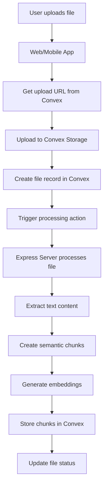

# File Processing and Chunk Management Architecture

## Overview

This document explains how file processing works in the hybrid Convex + Express architecture, including chunk creation, storage, and retrieval for AI operations.

## File Processing Flow



## Detailed Steps

### 1. File Upload (Client → Convex)

```typescript
// Client code (web/mobile)
const uploadFile = async (file: File) => {
  // Get upload URL from Convex
  const uploadUrl = await convexMutation(api.files.generateUploadUrl);
  
  // Upload file to Convex storage
  const result = await fetch(uploadUrl, {
    method: "POST",
    body: file,
  });
  
  const { storageId } = await result.json();
  
  // Save file metadata
  const fileId = await convexMutation(api.files.saveFile, {
    storageId,
    filename: file.name,
    mimeType: file.type,
    size: file.size,
  });
  
  return fileId;
};
```

### 2. File Processing Trigger (Convex → Express)

```typescript
// convex/files/mutations.ts
export const saveFile = mutation({
  args: {
    storageId: v.id("_storage"),
    filename: v.string(),
    mimeType: v.string(),
    size: v.number(),
  },
  handler: async (ctx, args) => {
    const userId = await getAuthUserId(ctx);
    if (!userId) throw new Error("Not authenticated");
    
    // Save file record
    const fileId = await ctx.db.insert("files", {
      userId,
      storageId: args.storageId,
      filename: args.filename,
      mimeType: args.mimeType,
      size: args.size,
      processingStatus: "pending",
      createdAt: Date.now(),
    });
    
    // Get file URL for processing
    const fileUrl = await ctx.storage.getUrl(args.storageId);
    
    // Schedule processing via action
    await ctx.scheduler.runAfter(0, internal.files.processFile, {
      fileId,
      fileUrl,
      mimeType: args.mimeType,
    });
    
    return fileId;
  },
});
```

### 3. File Processing (Convex Action → Express)

```typescript
// convex/files/actions.ts
export const processFile = action({
  args: {
    fileId: v.id("files"),
    fileUrl: v.string(),
    mimeType: v.string(),
  },
  handler: async (ctx, args) => {
    // Update status to processing
    await ctx.runMutation(internal.files.updateStatus, {
      fileId: args.fileId,
      status: "processing",
    });
    
    try {
      // Call Express server for processing
      const response = await fetch(`${EXPRESS_URL}/api/files/process`, {
        method: 'POST',
        headers: {
          'Content-Type': 'application/json',
          'X-API-Key': process.env.EXPRESS_API_KEY,
        },
        body: JSON.stringify({
          fileId: args.fileId,
          fileUrl: args.fileUrl,
          mimeType: args.mimeType,
        }),
      });
      
      if (!response.ok) {
        throw new Error(`Processing failed: ${response.statusText}`);
      }
      
      const result = await response.json();
      
      // Store chunks in Convex
      await ctx.runMutation(internal.files.storeChunks, {
        fileId: args.fileId,
        chunks: result.chunks,
        extractedText: result.fullText,
      });
      
      // Update file status
      await ctx.runMutation(internal.files.updateStatus, {
        fileId: args.fileId,
        status: "completed",
      });
    } catch (error) {
      await ctx.runMutation(internal.files.updateStatus, {
        fileId: args.fileId,
        status: "failed",
        error: error.message,
      });
    }
  },
});
```

### 4. Text Processing & Chunking (Express Server)

```javascript
// server/routes/files.routes.js
router.post('/process', authenticateAPI, async (req, res) => {
  const { fileId, fileUrl, mimeType } = req.body;
  
  try {
    // Download file from URL
    const fileBuffer = await downloadFile(fileUrl);
    
    // Extract text based on file type
    let extractedText = '';
    
    if (mimeType === 'application/pdf') {
      extractedText = await processPDF(fileBuffer);
    } else if (mimeType.startsWith('image/')) {
      extractedText = await processImageWithOCR(fileBuffer);
    } else if (mimeType.includes('word')) {
      extractedText = await processWord(fileBuffer);
    } else if (mimeType.includes('powerpoint')) {
      extractedText = await processPowerPoint(fileBuffer);
    } else {
      extractedText = fileBuffer.toString('utf-8');
    }
    
    // Create semantic chunks
    const chunks = await createSemanticChunks(extractedText);
    
    // Generate embeddings for each chunk
    const chunksWithEmbeddings = await Promise.all(
      chunks.map(async (chunk, index) => ({
        chunkIndex: index,
        content: chunk.content,
        embedding: await generateEmbedding(chunk.content),
        metadata: {
          startChar: chunk.startChar,
          endChar: chunk.endChar,
          pageNumber: chunk.pageNumber,
        }
      }))
    );
    
    res.json({
      success: true,
      fullText: extractedText,
      chunks: chunksWithEmbeddings,
    });
  } catch (error) {
    logger.error('File Processing', error);
    res.status(500).json({ error: error.message });
  }
});
```

### 5. Chunk Storage (Convex)

```typescript
// convex/files/mutations.ts
export const storeChunks = internalMutation({
  args: {
    fileId: v.id("files"),
    chunks: v.array(v.object({
      chunkIndex: v.number(),
      content: v.string(),
      embedding: v.array(v.number()),
      metadata: v.any(),
    })),
    extractedText: v.string(),
  },
  handler: async (ctx, args) => {
    // Update file with extracted text
    await ctx.db.patch(args.fileId, {
      extractedText: args.extractedText,
      chunkCount: args.chunks.length,
    });
    
    // Store each chunk
    for (const chunk of args.chunks) {
      await ctx.db.insert("fileChunks", {
        fileId: args.fileId,
        userId: (await ctx.db.get(args.fileId))!.userId,
        chunkIndex: chunk.chunkIndex,
        content: chunk.content,
        embedding: chunk.embedding,
        metadata: chunk.metadata,
      });
    }
  },
});
```

## Chunk Retrieval Methods

### 1. Get All Chunks for a File

```typescript
// convex/files/queries.ts
export const getFileChunks = query({
  args: { fileId: v.id("files") },
  handler: async (ctx, args) => {
    const userId = await getAuthUserId(ctx);
    if (!userId) throw new Error("Not authenticated");
    
    // Verify file ownership
    const file = await ctx.db.get(args.fileId);
    if (!file || file.userId !== userId) {
      throw new Error("File not found");
    }
    
    // Get all chunks
    const chunks = await ctx.db
      .query("fileChunks")
      .withIndex("byFileId", (q) => q.eq("fileId", args.fileId))
      .order("asc")
      .collect();
    
    return chunks;
  },
});
```

### 2. Semantic Search Across Chunks

```typescript
// convex/files/queries.ts
export const searchFileContent = query({
  args: {
    query: v.string(),
    fileIds: v.optional(v.array(v.id("files"))),
    limit: v.optional(v.number()),
  },
  handler: async (ctx, args) => {
    const userId = await getAuthUserId(ctx);
    if (!userId) throw new Error("Not authenticated");
    
    // Generate embedding for search query
    const queryEmbedding = await generateEmbedding(args.query);
    
    // Vector search across chunks
    let vectorQuery = ctx.db
      .query("fileChunks")
      .withSearchIndex("byEmbedding", (q) => 
        q.search("embedding", queryEmbedding)
          .eq("userId", userId)
      );
    
    // Filter by specific files if provided
    if (args.fileIds && args.fileIds.length > 0) {
      vectorQuery = vectorQuery.filter((q) =>
        q.or(...args.fileIds.map(fileId => q.eq(q.field("fileId"), fileId)))
      );
    }
    
    const results = await vectorQuery.take(args.limit || 10);
    
    // Return chunks with relevance scores
    return results.map((chunk) => ({
      ...chunk,
      relevanceScore: chunk._score,
    }));
  },
});
```

### 3. Context Building for AI

```typescript
// convex/chat/helpers.ts
export async function buildContextFromFiles(ctx: any, fileIds: string[], query: string) {
  // Search for relevant chunks
  const relevantChunks = await ctx.runQuery(internal.files.searchFileContent, {
    query,
    fileIds,
    limit: 5, // Top 5 most relevant chunks
  });
  
  // Combine chunks into context
  const context = relevantChunks
    .map(chunk => chunk.content)
    .join("\n\n---\n\n");
  
  return {
    context,
    sources: relevantChunks.map(chunk => ({
      fileId: chunk.fileId,
      chunkIndex: chunk.chunkIndex,
      relevance: chunk.relevanceScore,
    })),
  };
}
```

## Chunking Strategies

### 1. Semantic Chunking (Default)
```javascript
// server/services/chunkingService.js
export async function createSemanticChunks(text, options = {}) {
  const {
    maxChunkSize = 1000,
    overlapSize = 200,
    minChunkSize = 100,
  } = options;
  
  // Split by paragraphs first
  const paragraphs = text.split(/\n\n+/);
  const chunks = [];
  let currentChunk = '';
  let startChar = 0;
  
  for (const paragraph of paragraphs) {
    if (currentChunk.length + paragraph.length > maxChunkSize) {
      // Save current chunk
      if (currentChunk.length >= minChunkSize) {
        chunks.push({
          content: currentChunk.trim(),
          startChar,
          endChar: startChar + currentChunk.length,
        });
      }
      
      // Start new chunk with overlap
      const overlapText = currentChunk.slice(-overlapSize);
      currentChunk = overlapText + '\n\n' + paragraph;
      startChar += currentChunk.length - overlapText.length;
    } else {
      currentChunk += '\n\n' + paragraph;
    }
  }
  
  // Add final chunk
  if (currentChunk.length >= minChunkSize) {
    chunks.push({
      content: currentChunk.trim(),
      startChar,
      endChar: startChar + currentChunk.length,
    });
  }
  
  return chunks;
}
```

### 2. Fixed-Size Chunking
```javascript
export function createFixedChunks(text, chunkSize = 1000, overlap = 200) {
  const chunks = [];
  
  for (let i = 0; i < text.length; i += chunkSize - overlap) {
    chunks.push({
      content: text.slice(i, i + chunkSize),
      startChar: i,
      endChar: Math.min(i + chunkSize, text.length),
    });
  }
  
  return chunks;
}
```

## Use Cases

### 1. Chat with Documents
```typescript
// When user asks a question about uploaded files
const chatWithFiles = async (question: string, fileIds: string[]) => {
  // Get relevant context from files
  const context = await convexQuery(api.chat.buildFileContext, {
    question,
    fileIds,
  });
  
  // Send to AI with context
  const response = await fetch(`${EXPRESS_URL}/api/ai/chat/complete`, {
    method: 'POST',
    headers: {
      'Content-Type': 'application/json',
      'X-API-Key': EXPRESS_API_KEY,
    },
    body: JSON.stringify({
      messages: [
        { role: 'user', content: question }
      ],
      context: context.text,
      model: 'gpt-4',
    }),
  });
  
  return response.json();
};
```

### 2. Generate Quiz from File
```typescript
// Extract content and generate quiz
const generateQuizFromFile = async (fileId: string) => {
  // Get file chunks
  const chunks = await convexQuery(api.files.getFileChunks, { fileId });
  
  // Combine chunks (or select most important ones)
  const content = chunks
    .slice(0, 5) // First 5 chunks
    .map(chunk => chunk.content)
    .join('\n\n');
  
  // Generate quiz
  const response = await fetch(`${EXPRESS_URL}/api/ai/quiz/generate`, {
    method: 'POST',
    headers: {
      'Content-Type': 'application/json',
      'X-API-Key': EXPRESS_API_KEY,
    },
    body: JSON.stringify({
      content,
      questionCount: 10,
    }),
  });
  
  return response.json();
};
```

## Performance Considerations

1. **Chunk Size**: Balance between context and token limits
   - Recommended: 500-1500 tokens per chunk
   - Overlap: 10-20% for continuity

2. **Embedding Generation**: 
   - Batch processing for efficiency
   - Cache embeddings to avoid regeneration

3. **Vector Search**:
   - Convex supports up to 1536 dimensions (OpenAI embeddings)
   - Limit search results for performance

4. **Storage**:
   - Chunks are stored separately from files
   - Allows for efficient querying and updates

## Summary

- **Files** are uploaded to Convex Storage
- **Processing** happens on Express server (OCR, text extraction)
- **Chunks** are created with semantic boundaries
- **Embeddings** are generated for vector search
- **Storage** is in Convex with vector indexes
- **Retrieval** supports both direct access and semantic search
- **AI Context** is built from relevant chunks